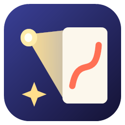

<p align="center">
  
</p>

<h1 align="center">LumiCanvas</h1>

밑그림 없이 그림을 그릴 수 있게 도와주는 **프로젝션 가이드** 앱입니다 (Windows 전용, C++20 · Qt 6 · Direct3D 11).

미리 준비한 단계별 이미지(예: AI로 만든 `step1.png … step12.png`)를 캔버스에 투사하고, 스페이스바로 다음 단계로 넘기면서 그 가이드를 따라 그립니다.

## 빌드

요구 사항: Visual Studio 2022(C++ 워크로드), CMake 3.21+, Qt 6.8 (msvc2022_64, Concurrent 모듈 포함)

```bash
cmake --preset msvc
cmake --build --preset debug
```

실행 파일: `build/Debug/LumiCanvas.exe` (빌드 후 windeployqt가 Qt DLL을 옆에 복사합니다)

Qt 경로가 `C:/Qt/6.8.2/msvc2022_64`가 아니면 `CMakeUserPresets.json`에서 `CMAKE_PREFIX_PATH`를 덮어쓰세요.

## 사용법

1. **Sequence → Open Folder**로 단계 이미지 폴더를 엽니다. 폴더나 이미지를 창에 끌어다 놓아도 됩니다.
   - 파일은 숫자 순서로 정렬됩니다 (`step2`가 `step10`보다 앞).
2. **Output → Open Output**으로 프로젝터에 출력 창을 엽니다.
3. **T**(정렬 패턴)를 켜고, 편집기에서 4개 코너를 실제 캔버스 모서리에 맞춥니다.
   - 속성의 **Canvas**에 캔버스 실제 크기(mm)를 넣으면 이미지 비율이 유지됩니다.
4. **T**를 다시 눌러 끄고, 가이드를 따라 그립니다.
5. **File → Save**로 저장하면 정렬 상태와 현재 단계가 함께 저장됩니다.

| 키 | 동작 |
|---|---|
| Space / PageDown | 다음 단계 |
| Backspace / PageUp | 이전 단계 |
| Home / End | 처음 / 마지막 단계 |
| H | 가이드 켜기/끄기 (실제 칠한 색 확인용) |
| T | 정렬 패턴 |
| G | 가이드 표시 방식 전환 (일반 → 새 부분 강조 → 겹쳐 보기) |
| B (누르고 있는 동안) | 가이드 잠깐 끄기 |
| Esc (출력 창) | 출력 닫기 |
| Tab / Shift+Tab | 코너 선택 |
| 화살표 / Shift+화살표 | 선택한 코너 1px / 10px 이동 |
| Ctrl+Z / Ctrl+Y | 실행 취소 / 다시 실행 (정렬과 서피스 속성 변경) |

### 가이드 표시 방식 (Sequence 패널 → Guide Display)

- **새 부분 강조** (기본값): 이전 단계에서 바뀐 부분만 밝게, 이미 그린 부분은 어둡게 보여줍니다. 단계 이미지가 점점 쌓이는(누적형) 방식일 때 좋습니다. "Tint new parts"를 켜면 새 부분에 색을 입힙니다.
- **겹쳐 보기**: 현재 단계 위로 이전 단계를 흐리게 겹칩니다. 각 단계 이미지에 그 단계의 새 부분만 담긴 경우에 좋습니다.
- **일반**: 현재 단계 이미지를 그대로 보여줍니다.

같은 패널에서 다음 항목도 조절합니다. 이 설정은 프로젝트에 함께 저장됩니다.

- **밝기**: 캔버스에 비치는 빛의 세기를 줄입니다.
- **반전**: 흰 바탕에 검은 선인 이미지를 검은 바탕에 밝은 선으로 바꿉니다. 빛이 덜 퍼져서 캔버스가 잘 보입니다.
- **선 색**: 이미지 밝기를 유지한 채 고른 색으로 표시합니다.
- **격자**: 실제 캔버스 기준(mm) 격자를 겹칩니다. 속성의 Canvas 크기가 정확해야 칸 크기도 맞습니다.

### 다시 맞추기

프로젝터나 캔버스가 밀렸으면 **T**를 누릅니다. 코너 위치가 흰 표시로, 선택한 코너가 노란 표시로 투사됩니다. 정렬 패턴이 켜져 있는 동안에는 캔버스 앞에서 무선 키보드로 `Tab`과 화살표를 눌러 출력 창에서 바로 맞출 수 있습니다. 속성의 Corner 칸에 픽셀 좌표를 직접 넣어도 됩니다.

### 키 설정 (리모컨, 발 페달)

단계 키는 출력 창에 포커스가 있을 때도 동작합니다. 리모컨과 발 페달은 대부분 키 입력을 보내므로 **보기 → 키 설정**에서 해당 버튼을 눌러 지정합니다. PageDown/PageUp은 기본으로 지정되어 있습니다.

명령줄: `LumiCanvas.exe [프로젝트.lumi | 이미지 폴더] [--windowed-output]`

### 이미지에서 단계 자동 생성

완성 이미지 한 장만 있으면 단계 이미지를 만들 수 있습니다. **시퀀스 → 이미지에서 단계 생성**(Ctrl+G)을 열고 이미지를 고르면 미리보기를 보며 조절할 수 있습니다.

- **나누는 기준**: 색 영역, 또는 명암(회색).
- **영역 수**: 많을수록 작은 색까지 나뉩니다. 작은 부분의 색이 합쳐져 보이면 값을 올리세요.
- **칠하는 순서**: 어두운 곳부터 또는 밝은 곳부터.
- **외곽선으로 시작**, **선 세밀도**, **마지막에 원본 이미지 표시**.

결과는 `이미지이름_steps` 폴더에 `step01_outline.png`처럼 저장되고 바로 시퀀스로 열립니다. 비어 있지 않은 폴더에는 저장하지 않아 이전 결과를 덮어쓰지 않습니다.

프로젝터는 검은색을 투사할 수 없어서, 어두운 영역도 보이도록 실제 색보다 밝게 표시됩니다. 마지막 원본 단계는 원래 색 그대로입니다.

명령줄: `LumiCanvas.exe 이미지.png --generate-steps 출력폴더` (기본 설정으로 생성하고 창 없이 종료)

### 언어

**보기 → 언어**에서 한국어, English, 시스템 기본값 중에서 고릅니다. 바꾼 언어는 다시 시작하면 적용됩니다.

UI 문자열을 바꾼 뒤에는 번역 파일을 갱신하세요. 그다음 `translations/lumicanvas_ko.ts`의 새 항목을 Qt Linguist 등으로 번역합니다.

```bash
cmake --build build --target update_translations --config Debug
```

## 구조

| 경로 | 역할 |
|---|---|
| `src/core/Project` | 서피스(코너, 캔버스 크기, 배치 방식, 콘텐츠), `.lumi` JSON 저장/불러오기 |
| `src/core/Sequence` | 단계 이미지 목록, 현재 단계, 백그라운드 미리 불러오기 |
| `src/core/History` | 실행 취소/다시 실행 (서피스 스냅샷 기반, 연속 편집은 한 단계로 합침) |
| `translations/` | UI 번역 (.ts) |
| `src/core/StepGenerator` | 완성 이미지를 누적 단계로 분할 (색 군집화, 외곽선 검출, 파일 저장) |
| `resources/icons/` | 앱 아이콘 (`tools/make_icon.ps1`로 다시 생성) |
| `tests/` | 자동 테스트 (`ctest --test-dir build -C Debug`) |
| `src/core/ImageLoader` | 스레드에서 안전하게 쓸 수 있는 이미지 로더 |
| `src/render/RenderEngine` | D3D11 디바이스와 렌더 스레드, 출력마다 flip-model 스왑체인 |
| `src/render/OutputWindow` | 프로젝터 출력용 네이티브 창 |
| `src/ui/MainWindow` | 편집기 UI (시퀀스, 서피스, 출력 패널) |
| `src/ui/WarpEditor` | 코너 정렬 캔버스 |
| `resources/shaders/warp.hlsl` | 원근 보정 쿼드 워프, 배치(Fit/Fill/Stretch), 테스트 패턴 |
